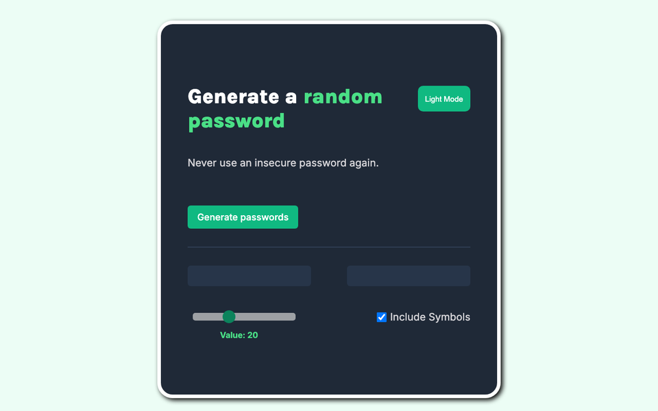

# Password Generator 🔐

Generates random passwords in the browser: nothing is sent anywhere.

**Live demo:** https://mccprogrammer.github.io/password-generator/



## Features

- Two passwords per click
- Length slider
- Include or leave out symbols
- Light and dark mode

## Run it locally

No build step: clone the repo and open `index.html` in a browser.

```bash
git clone https://github.com/MCCProgrammer/password-generator.git
open password-generator/index.html
```

## Built with

HTML, CSS and plain JavaScript.

---

One of my first web projects. More of my work at [mccprogrammer.com/projects](https://mccprogrammer.com/projects).
